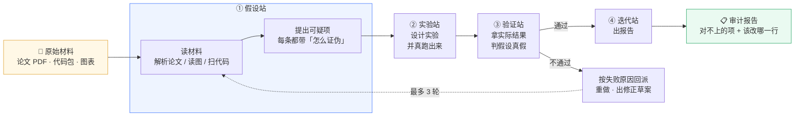
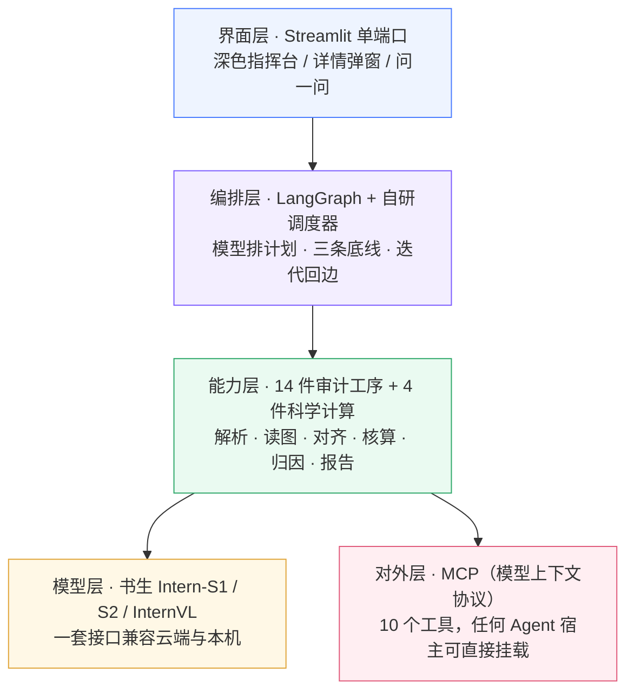
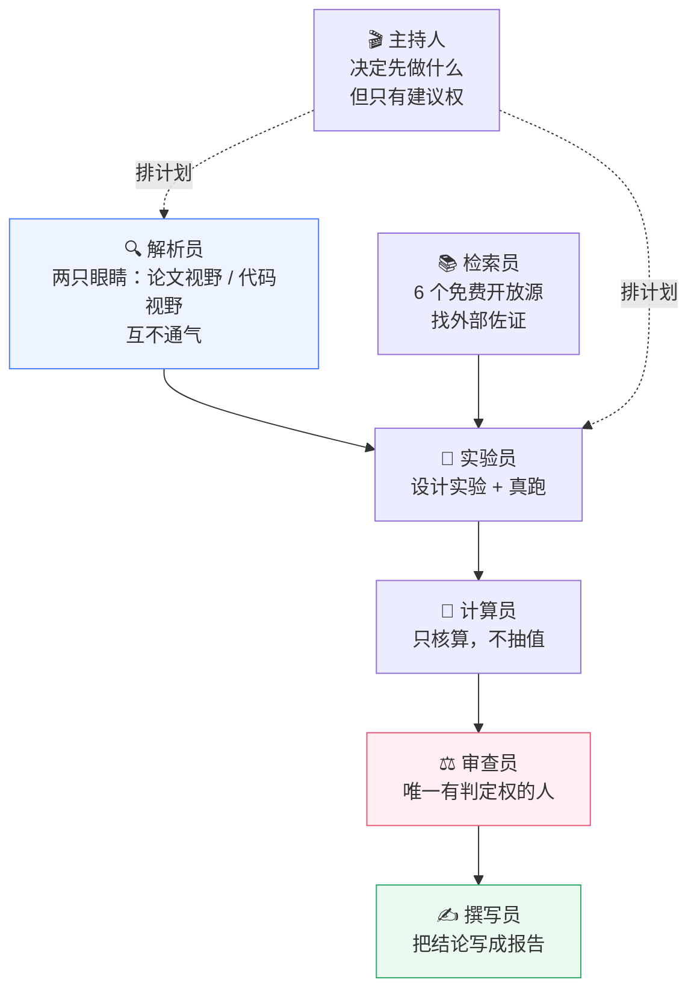

# Paper2Lab · 项目技术方案与视频录制台词

> 这份文件有两个用途：
> 一、当**技术方案说明书**看——技术栈、每个功能的实现方式、对应赛题的哪一条要求。
> 二、当**视频台词草稿**念——每个小节标题下面的「口播」段落就是可以直接读的话，`〔画面〕` 是给剪辑的提示。
>
> 全程口径原则：**只说代码里真的有的东西**。凡是本项目没做的，文末「口径红线」里逐条列了，录制时别说漏嘴。

---

## 0. 开场：一句话让人记住我们在做什么

〔画面〕桌面双击打开网页，首屏深色指挥台缓缓亮起，三块材料卡片依次出现。

**口播：**

> 现在做科研最难受的一件事，不是想不出点子，而是——**你好不容易把别人的论文复现了一遍，结果数对不上，你却不知道该改哪儿。**
>
> 论文里写学习率 1e-4，代码里是 0.001，差了十倍。你在自己机器上跑出来，FID 差了 8 个点。你翻遍论文，论文没说；你看代码，代码没注释。
>
> 这就是 **Paper2Lab** 要解决的问题。它不帮你写论文，也不帮你找文献——它专门干一件事：**把你的实验材料摊在桌上，一条一条告诉你，哪里对不上、为什么对不上、该改哪一行。**
>
> 一句话：**它是科研实验的"对账员"。**

---

## 1. 现实痛点：四个真实场景

〔画面〕屏幕分四格，每格一个场景，逐格亮起。

**口播：**

> 我们把科研里最浪费时间的四件事拆开看：

| 痛点 | 现场长什么样 | 现在大家怎么扛 | 代价 |
|---|---|---|---|
| **文献处理低效** | 一篇 30 页论文，图表十几张，关键参数藏在图注和表头里 | 人工一页页翻，翻完还得手抄进 Excel | 半天起步，还漏 |
| **实验范式传统** | 论文写的数、代码跑的数，没人系统核过 | 靠"感觉差不多"就往下做 | 复现失败，白跑两周 |
| **AI 落地成本高** | 一想到用大模型，先想到要买 API、要几十 G 显存 | 干脆不用 | 能力浪费 |
| **结论不可追溯** | 通用模型给你一段漂亮话，问它"哪来的"就说不清 | 只能全信或全不信 | 不敢用在正式场合 |

**口播（接上表）：**

> 这四条，其实就是赛题背景里说的那两句：**科研领域文献处理低效、实验范式传统**。
>
> 而我们做的，就是拿一个能自己动手的智能体，把这四个坑一个个填掉。
>
> 特别说一下第三个坑——**成本**。我们这套东西，在一台 8G 显存的笔记本上，用**完全免费的本机书生小模型**就能跑完整条链路。不是演示级跑通，是能出结论的那种跑通。

---

## 2. 它到底是什么：一张图说清

〔画面〕画面中间浮出四站流程图（第一张图）。

**口播：**

> 别看它界面上东西多，其实骨架就四站，四句话：**提、做、判、改。**



〔画面〕如果 mermaid 没渲染，用这一版：

```text
原始材料 ──▶ ① 假设站（读论文/读图/扫代码 → 提可疑项）
                     │
                     ▼
              ② 实验站（设计实验 + 真跑出数）
                     │
                     ▼
              ③ 验证站（拿实际值判假设）
                     │
        ┌────────────┴────────────┐
     通过                       不通过
        │                          │
        ▼                          ▼
   ④ 迭代站出报告          按失败原因回派重做
                                  │
                                  └──▶ 回到 ①（最多 3 轮）
```

**口播：**

> 关键在**分界**，四站靠"输入什么、输出什么"来分，不是靠名字好听：
>
> - ① 站吃**原始材料**，吐**假设卡**——注意，它吐的不是"最可能的方案"，而是"**可疑项 + 这一项怎么证伪**"；
> - ② 站吃**假设卡**，吐**实验卡**——而且它**只出数、不做判断**；
> - ③ 站吃**实际值**，吐**判定卡**——它在结构上就拿不到"自己造数"的能力；
> - ④ 站吃不通过的项，吐**报告 + 修正建议**。
>
> 这个分界不是设计洁癖，是为了解决一个大模型的通病：**它太爱编数了。** 只要让"算数的人"和"下判断的人"是同一个人，它就会先编一个好看的结果，再顺着结果编理由。我们把这两件事拆成两个人，问题从**纪律问题**变成了**结构问题**。

---

## 3. 技术栈：每一层用什么、为什么用它

〔画面〕技术栈图（第二张图），一层层往下点亮。

**口播：**

> 技术栈分五层，从上往下说：



### 3.1 逐项对照表

| 层 | 用什么 | 为什么是它 | 落在哪个文件 |
|---|---|---|---|
| 界面 | **Streamlit**（单端口，含弹窗、图表、状态卡） | 一个进程一个端口就能交付完整产品，评委打开浏览器就能用，不用装客户端 | `app.py`（3213 行） |
| 编排 | **LangGraph** 状态图 | 科研流程是**带环的图**不是直线：不通过要回到①站重来。LangGraph 天然支持条件边和循环，比手写状态机稳 | `paper2lab/graph.py`（1579 行） |
| 调度 | **自研 planner**：模型排计划 + 规则兜底 | 纯固定流程太死，纯模型排计划会乱砍步骤。我们让模型排，但给它三条底线 | `paper2lab/planner.py` |
| 解析 | **PyMuPDF** 抽正文与版式；**多语言归一** | 中文论文、英文论文、LaTeX 公式混排都能吃 | `paper2lab/paper_parser.py` |
| 读图 | **多模态视觉通道**（书生 InternVL / Intern-S1 系列） | 关键参数常藏在图注和坐标轴里，纯文本抽不到 | `paper2lab/vision.py` + `paper2lab/multimodal/` |
| 代码 | 静态扫描（语言无关的取值器） | 不执行别人的代码，只读，安全 | `paper2lab/code_analyzer.py` |
| 对齐 | **参数同义词归一 + 数值比对** | "learning rate" / "lr" / "学习率" 是同一个东西，得先认成一家 | `paper2lab/synonyms.py` + `aligner.py` |
| 算数 | **4 件具名科学计算工具** | ② 站必须真算，不能问模型"你觉得是多少" | `paper2lab/scifuncs.py` |
| 判定 | **程序判 + 模型先判对照**（双轨，互不覆盖） | 让模型先说，程序独立再判一遍，一致就加分，不一致就并列展示 | `paper2lab/judge_llm.py` |
| 多智能体 | 七个角色 + 三方独立抽取 + 对撞 + 仲裁 + 红队 | 单模型自问自答会自我强化，必须让"另一个不知情的观察者"来撞 | `paper2lab/collider.py`、`agent_roles.py` |
| 记忆 | 三层指纹 + 跨任务统计 | 同一篇论文第二次审，不该从零开始 | `paper2lab/memory.py` |
| 闭环 | **复算 / 引证检索 / 复现方案 / 迭代回边** | "验证"不能只靠嘴，"可复现"要落到步骤清单 | `compute.py`、`retrieval.py`、`repro_plan.py`、`loop.py` |
| 文献 | **6 个免费开放源**（OpenAlex / Crossref / Europe PMC / arXiv / DataCite / DOAJ） | 零成本、无需 key、覆盖 2.6 亿+ 条 | `paper2lab/literature.py` |
| 模型 | **书生 Intern-S1 / S2-397B / S1 Pro / InternVL** 统一接口 | 赛题硬要求；且同一套代码云端和本机都能跑，只改配置不改代码 | `paper2lab/llm.py` |
| 对外 | **MCP** 标准协议，10 个工具 | 好东西不该锁在一个网页里，别的 Agent 也应能直接调 | `paper2lab/mcp_server.py` |

### 3.2 规模与工程化

**口播：**

> 顺便报个数，都是代码里数出来的，不是估的：

| 指标 | 数量 |
|---|---|
| 核心产品代码 | 约 **3.1 万行**（`app.py` + `paper2lab` 62 个模块） |
| 自动化检查 | **62 项**（离线即可跑，不需要联网、不花钱） |
| 审计工序 | **14 件**，加 4 件科学计算工具，共 **15 个进度格** |
| 运行时节点 | LangGraph **23 步**（随材料与档位动态变化） |
| 对外 MCP 工具 | **10 个** |

**口播（接上）：**

> 62 项检查这件事我想单独说一句，因为它是这个项目最"不性感"但最要命的部分。
>
> 里面有一条检查叫「**模型返回的参数必须真的生效**」。听起来很无聊对吧？但我们真的踩过这个坑：程序收了"模型地址"和"模型名"两个参数，**收了却没用**，还写死 30 秒超时。结果就是——你在页面上选了云端，程序偷偷去调本机；本机小模型 30 秒答不完，排计划永远退回规则版。
>
> 界面上看起来"一切正常"，因为**它自己降级了，还不告诉你**。这种 bug 靠人眼看不出来，只能靠这种"盯着代码看"的自动检查。查出这类问题，比多加十个功能更有价值。

---

## 4. 七个智能体：不是七个模型，是七份工作

〔画面〕七个角色围绕四站排开（第三张图）。

**口播：**

> 我们对外讲"七个智能体协作"，但必须先说清一件事，否则就是吹牛：**这不是开了七个大模型，是把一份科研工作拆成七份岗位。**
>
> 这七个岗位是：**解析员、检索员、主持人、实验员、计算员、审查员、撰写员。**
>
> 它们之间没有"总控大脑"层层审批，而是靠**交接物**驱动——上一棒交出一张卡，下一棒拿着卡干活。这样有个好处：任何一刻出问题，你都能指着一份具体的产物说"是这里错了"，而不是"模型抽风了"。



**口播：**

> 有两条设计我认为是这个项目最值钱的地方，请大家留意：
>
> **第一，隔离不在角色之间，而在解析员的内部。**
> 听起来反直觉——按理说应该一个"只看论文的"和一个"只看代码的"分开吧？我们是这么做的：解析员一个人，但他有两只眼睛。左眼看论文，说出"论文写 1e-4"；右眼看代码，说出"代码写 0.001"。**两只眼睛互相不知道对方看到了什么**，最后才把两张纸条摊在一起。
>
> 为什么这样做？因为如果让它们通气，第二个会被第一个带跑——"论文说 1e-4，那代码应该也是 1e-4 吧"。这一带，最关键的差异就被抹平了。
>
> **第二，调用权给模型，校验权留审查员。**
> 模型可以决定"我要跑哪个计算工具"，但它**不能决定"结果算不算通过"**。判定权单独归审查员。这条线一划，模型就没法既当运动员又当裁判。

---

## 5. 三个技术硬骨头，以及我们怎么啃的

〔画面〕三段小动画，每段配一句标题。

### 5.1 模型排计划会"乱砍步骤"

**口播：**

> 我们让模型自己决定"这次要跑哪些步骤"。结果它真的会砍——实测它就砍过**实验站**，理由是"没有实测结果，无法执行实验设计"。
>
> 这个理由听起来挺有道理，其实是**错的**：实验站会自己重算，根本不需要你先给结果。它砍掉的那一站，恰好是产出实验卡的地方。砍完，四站直接变两站。
>
> 我们的做法不是"把决定权收回来"（那就退回死流程了），而是给它**三条底线**：结论产出、假设生成、实验设计。这三件，模型说跳过也不生效，照样执行，并且在理由栏如实写"**模型判定跳过，已按底线兜底执行**"——模型的原话一个字不删。
>
> 除这三件之外，模型说跳什么就跳什么。
>
> 实测对比很直接：同一份模型计划，只改这一处，**实验卡从 0 张变成 5 张**，判定条数和假设卡数量完全不变。

### 5.2 模型很会编数

**口播：**

> 大模型最危险的地方不是不会，是**它会编，而且编得很像**。
>
> 我们做了两层防线：
>
> 一层是**结构上的**——③ 站的判定环节，程序上就**拿不到**"输入的原始数值"这个字段。它只能拿到"实际算出来的值"和"论文声称的值"两个东西来比。它想造数，没有素材。
>
> 另一层是**流程上的**——"模型先判，程序后判，两条线并列"。让模型先说它的判断，然后程序**独立跑一遍完整判定**（注意，不是去"复核模型说的话"，是从头自己判），最后把两边结果摆在一起。一致就标"一致"，不一致就**两边都留着，永远不许模型覆盖程序**。
>
> 这条我特别想说：**"让模型先判"本身不会提升准确率**——这个结论我们还没做完整对照实验，所以对外我们绝不说"放权给模型能提高准确率"。我们只说：**它让我们看得见模型和程序在哪儿分歧。**

### 5.3 8G 显卡怎么跑得动

**口播：**

> 这是最现实的一条。赛题要求基于书生大模型，而书生最大的那个模型要几十 G 显存，普通学生根本跑不动。
>
> 我们的解法是：**同一套代码，云端和本机只改配置，不改一行代码。**
>
> 本机跑的是书生的 Intern-S1-mini（8B，量化后 8.6GB），用 llama.cpp 起一个本地服务。写代码的时候只填三个框：地址、模型名、key 填 `local`。
>
> 但这里有个坑必须讲，因为它决定了"能不能用"：**小模型出字速度只有每秒 10 个 token 左右。** 原来代码里写死"1800 token / 75 秒超时"，在云端够用，在本机**必然超时**。我们实测过一次：一个问答卡了 152 秒，然后报失败。
>
> 所以超时和长度不能写死，得**按端点算**：本机给 1000 token / 360 秒，云端给 1800 token / 75 秒，一处算清，所有调用方只取用。
>
> 改完之后，同一台 8G 笔记本，跑完整条审计链路：**冷启动 99 秒**，出 13 条判定、5 张假设卡、5 张实验卡、自检 13 项全过、报告 2.46 万字。

---

## 6. 逐条对上赛题：AI4S 方向要求的「搜读算做写」

〔画面〕左边赛题要求，右边我们的实现，一条条对上。

**口播：**

> 赛题方向一是 AI4S 科学智能体，要求覆盖「搜、读、算、做、写」全链条。我们一条条对：

| 赛题要求 | 我们对应做了什么 | 落在哪 |
|---|---|---|
| **搜**：文献与多模态数据精准检索 | 6 个免费开放源联合检索（OpenAlex 2.6 亿条 / Crossref 1.6 亿 / arXiv / Europe PMC / DataCite / DOAJ），查不到就**如实说查不到**，不编 | `literature.py` |
| **读**：长文本与科学数据理解 | 论文正文 + 版式解析；**图表走多模态读图**；化学式有独立核验工具（不靠读图，直接按化学规则算） | `paper_parser.py`、`vision.py`、`chem.py` |
| **算**：科学计算工具自主调用 | 4 件具名工具：**数值精度复算 / 序列统计 / 线性拟合 / 峰值拾取**。模型自己挑，挑完真跑，留下输入、输出、耗时的执行记录 | `scifuncs.py` |
| **做**：实验与仿真方案设计 | ② 实验站：把假设卡变成可执行的实验卡（算什么、调哪个工具、预期什么量级） | `experiment.py` |
| **写**：结果可复现验证与迭代优化 | 复现方案生成 + 可复现性评级；不通过项按失败原因回派，最多 3 轮；报告给到"该改哪一行" | `repro_plan.py`、`loop.py`、`report.py` |

**口播（接表）：**

> 赛题还点名了几项前沿技术，我们也逐条对：

| 赛题点名的技术 | 我们怎么用的 |
|---|---|
| **基于书生大模型** | 全部模型调用走统一定义，支持 Intern-S2-397B、Intern-S1 Pro、InternVL 系列；默认跑本机 Intern-S1-mini，切云端改配置即可 |
| **任意 harness** | 用 **LangGraph** 做编排（带环状态图），不用死流程 |
| **MCP 协议** | 10 个能力封装成标准 MCP 工具，`stdio` 直连，任何支持 MCP 的宿主都能挂载 |
| **多智能体协同编排** | 七个岗位 + 三方独立抽取 + 对撞 + 仲裁 + 红队 |
| **上下文工程与长周期记忆** | 三层指纹记忆：论文指纹 / 论文+代码指纹 / 会话快照；同一篇论文再审，历史结论直接带出来 |
| **工具自主调用** | 模型自己排计划、自己挑工具、自己决定先后 |

**口播：**

> 有一条我想强调，因为它最能体现"这是个智能体，不是一个脚本"：
>
> **同一个材料，跑第二次，它记得上一次的结论。**
>
> 这不是"缓存"——缓存是存结果。我们存的是**上一次发现过什么问题、修没修、修完还剩什么**。第三次打开同一篇论文，它会主动提示"上次这里有 3 条没过，其中 1 条你已经改了"。这才叫长周期记忆。

---

## 7. 实测数据：让数字说话

〔画面〕数据条一个个弹出来。

**口播：**

> 下面这些数字都是真跑出来的，不是估算：

| 项目 | 结果 |
|---|---|
| 冷启动全链路（清空缓存） | **99 秒**跑完四站 |
| 判定条数 | 13 条 |
| 假设卡 / 实验卡 | 5 张 / 5 张 |
| 自检 | 13 项**全过** |
| 报告篇幅 | 2.46 万字 |
| 就绪度评分 | 85 / 100 |
| 四套不同材料 | 中文三材料、英文 DDPM、D 题、仅论文——**全部跑通** |
| 独立能力测试 | 30 项**全过** |
| 网页端真机测试 | 29 项**全过** |
| 离线自动检查 | 62 项**全过** |

**口播（接上）：**

> 举个具体的例子，让你感受一下它的输出长什么样。
>
> 我们拿一份真实的材料跑，它给出来的是这么一句话：
>
> **"论文写学习率 1e-4，代码 `train.py` 第 11 行写的是 0.001，相差 10 倍。按论文值跑，前 500 步 loss 会震荡不收敛。"**
>
> 不是"建议检查学习率参数"这种废话，是**具体到文件名、行号、倍数、后果**。
>
> 再比如它发现调度器的配置不一致、随机种子的传递方式不对——这些都是"你对着两堆文件看三天也看不出来"的东西。

---

## 8. 收尾：我们想留下什么

〔画面〕四站图重新亮起，然后收成一行字。

**口播：**

> 最后说一句我心里的话。
>
> 现在大家都在做"让 AI 帮你读论文、帮你写综述"。这当然有用。但我们觉得，科研里更痛的那个点，在**"做"这一端**——不是读不懂，是**做不出来，而且不知道为什么做不出来**。
>
> Paper2Lab 押的就是这一点。它不承诺"帮你发现新知识"，它承诺的是：**你交给它一堆材料，它会诚实地告诉你，哪里对不上，以及该改哪一行。**
>
> 它还承诺另一件事——**不确定就说不确定。** 查不到文献，它说查不到；模型判断和程序判断不一致，它把两句话并排放着，让你自己看。
>
> 一个科研工具最重要的品质不是聪明，是**诚实**。
>
> 这就是 Paper2Lab。谢谢大家。

---

## 附录 A：现场演示动线（约 3 分钟）

〔画面〕按顺序走，不跳步。

| 步骤 | 动作 | 说什么 |
|---|---|---|
| 1 | 打开 `http://127.0.0.1:8501` | "首屏就是指挥台，三块材料已经预置好了" |
| 2 | 不动材料，直接点「开始科研审计」 | "这里用的是内置样例，一份论文、一个代码包、一批图表" |
| 3 | 等进度条走过四站 | "注意看它现在在①站还是②站，四站是有颜色区分的" |
| 4 | 完成后看 KPI 卡 | "13 条判定、5 张假设卡、5 张实验卡、就绪度 85" |
| 5 | 点「审计发现」的某一条 | "点开看详情——它给了具体文件、具体行号、差多少倍" |
| 6 | 点「问一问」，问一句 | "你可以就这份材料继续追问，它答的时候会标明哪句是材料原文" |
| 7 | 切「执行记录」 | "每个工具什么时候调的、用了多久、成功还是空，全在这" |

**演示前必查三件事：**

1. 本机模型服务在跑（`http://127.0.0.1:8080/health` 返回 `{"status":"ok"}`）
2. 网页服务在跑（`http://127.0.0.1:8501` 返回 200）
3. 浏览器 **Ctrl+R 刷新一次**——页面上的模型输入框只在首次创建时读配置，不刷新可能还是旧值

---

## 附录 B：口径红线（录制时别说错）

这几条是从踩坑记录里提炼的，说错了会被懂行的人当场问住：

| ❌ 别说 | ✅ 应该说 | 为什么 |
|---|---|---|
| "我们跑过司南榜单" | "评测接口已按司南 / SciEvalKit 的插槽做好，题目用我们自己的" | 公开榜单里没有审计类题目，说了就是假的 |
| "宿主机上跑的是书生云端大模型" | "跑的是书生 Intern-S1-mini 本机版；云端 S2-397B / S1 Pro 改配置即可切换" | 诚实说明，且反而更能体现"低成本落地" |
| "放权给模型判定能提高准确率" | "模型先判 + 程序后判并排展示，让我们看见分歧在哪" | 完整 A/B 对照还没跑，不能下这个结论 |
| "实验站只跑一次、只算数" | "② 站只出数不下判断；判定在③站，且③站结构上拿不到原始输入值" | 这是我们的核心设计，说反了就丢了亮点 |
| "关闭了步骤就是失败" | "模型可以砍步骤，但三条底线砍不掉" | 决定权在模型，这是设计口径 |
| "有 7 个大模型在讨论" | "七个岗位分工，靠交接物驱动，没有总控层" | 生物学的"七个模型"是另一种架构，我们不是 |
| "自动切到小模型兜底" | "填云端就走云端、填本机就走本机，通道绝不偷换" | 偷换通道是降级且瞒着用户，体验更差 |

---

## 附录 C：一页速记（贴在提词器旁）

```text
名称      Paper2Lab · 科研实验智能一致性审计平台
方向      AI4S 科学智能体（赛题方向一）
一句话    科研实验的"对账员"：论文 vs 代码，哪里对不上、为什么、改哪行
骨架      四站：提 → 做 → 判 → 改（最多 3 轮回边）
团队      七个岗位：解析 · 检索 · 主持 · 实验 · 计算 · 审查 · 撰写
技术栈    Streamlit + LangGraph + 书生 Intern 系列 + MCP + 6 个免费文献源
规模      3.1 万行产品代码 / 14 件审计工序 / 4 件科学计算 / 10 个 MCP 工具
验证      62 项自动检查 · 30 项独立能力 · 29 项网页真机 · 冷启 99 秒
成本      8G 显卡 + 免费本机模型即可跑完整链路
底线      不造数、不编文献、不覆盖不一致、不偷换通道
```
